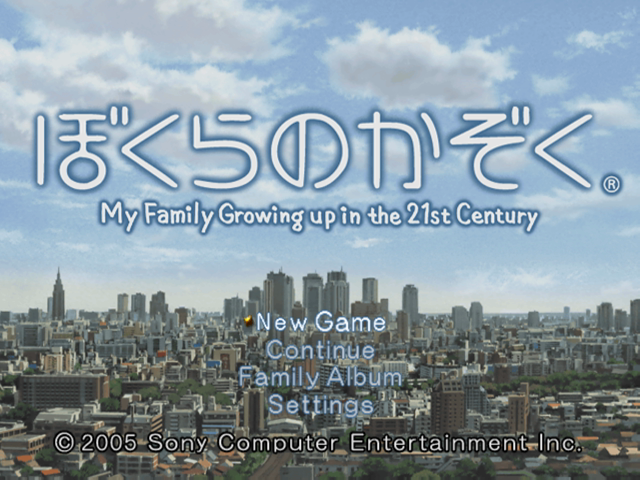
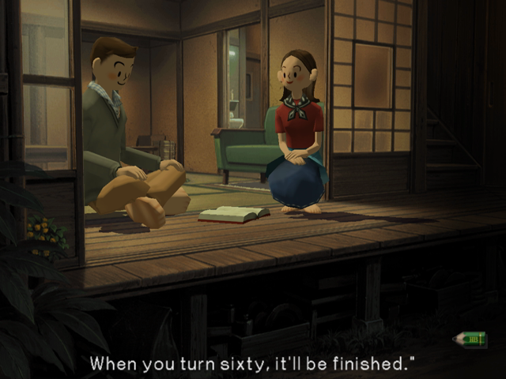
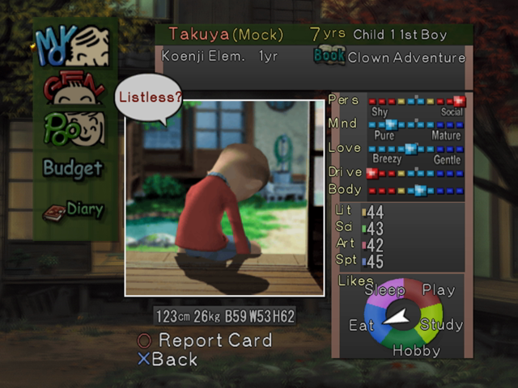
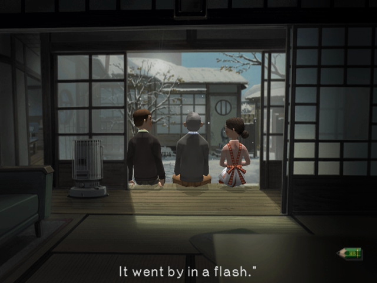

# Bokura no Kazoku — English Translation (PS2)

*ぼくらのかぞく — My Family Growing Up in the 21st Century* (Sony Computer Entertainment / Millennium Kitchen, 2005) is a Japan-only PlayStation 2 life sim: a young couple in suburban Tokyo fill one family diary across 35 years while their children grow up, one season at a time.

This project translates the whole game into English and ships it as a **patch** you apply to **your own copy** of the game.

 
 

## What's translated

- All story dialogue (2,750 unique scenes) and the Family News messages
- Every menu, help line, status screen, budget, settings and save/load message
- Names and descriptions of every book, school, club, job, part-time job, tutor and outing
- The entrance-exam quiz (rewritten as an English spelling/meaning quiz) and the minigames
- On-screen graphics: status gauge labels, season icons, menu badges, child portrait captions, minigame titles and prompts
- UI layouts were widened or rebalanced where English needed more room than Japanese

The original **Japanese voice acting is kept**. Book-cover artwork and the credits burned into the opening/ending movies remain in Japanese.

## What you need

1. **Your own copy of the game**, dumped to an ISO. The patch only works on this exact dump ([Redump](http://redump.org/discs/quicksearch/9d389b7c/)):

   | | |
   |---|---|
   | Title | Bokura no Kazoku: My Family Growing Up in the 21st Century (Japan) |
   | Serial | SCPS-15088, v1.00 |
   | Size | 2,091,941,888 bytes |
   | CRC32 | `9D389B7C` |
   | MD5 | `ab2edd392d190f21b2112d67219d4ea5` |
   | SHA-1 | `f2a8187457148a66fbbb3841032fe430cb5572d4` |

2. To play on PC: [PCSX2](https://pcsx2.net) and a **BIOS dumped from your own PS2**. To play on real hardware, burn the patched ISO for use on a console that can run backups.

Nothing in this repository or its releases contains the game, a BIOS, or any other copyrighted file you would need to obtain yourself. Please don't open issues asking for them.

## How to patch

Download the latest release from the **Releases** page.

**Windows (easiest):** run `Bokura no Kazoku Patcher.exe` (keep `BokuraNoKazoku_English.bps` next to it), pick your Japanese ISO, and it writes `Bokura no Kazoku (English).iso` next to it. It verifies your ISO first and verifies the result at the end.

> The patcher isn't code-signed, so Windows SmartScreen may warn about it. You can check the source in [`patcher/patcher.c`](patcher/patcher.c), build it yourself, or use one of the options below.

**Any OS (Python 3):**

```bash
python patcher/bps.py BokuraNoKazoku_English.bps "Bokura no Kazoku (Japan).iso" "Bokura no Kazoku (English).iso"
```

**Other tools:** the patch is a standard [BPS](https://www.romhacking.net/documents/746/) file, so Floating IPS or Rom Patcher JS also work.

Expected result: `Bokura no Kazoku (English).iso`, CRC32 `43E9CBF0`, SHA-1 `3c4e5fc0c88f509c07e422f407e81c21cea97e04`.

## One-click launcher (optional, Windows)

The **Launcher Kit** release gives a double-click setup:

1. Extract the kit to a folder.
2. Download the Windows portable build of PCSX2 from [pcsx2.net](https://pcsx2.net) and extract it into the kit's `PCSX2` folder (so that `PCSX2\pcsx2-qt.exe` exists).
3. Put your own PS2 BIOS dump into `PCSX2\bios` (any file name).
4. Put `Bokura no Kazoku (English).iso` next to `Play Bokura no Kazoku.exe`.
5. Double-click **Play Bokura no Kazoku.exe**.

The kit's PCSX2 settings start the game straight away in fullscreen with keyboard and gamepad controls already set up:

| PS2 | Keyboard | Gamepad |
|---|---|---|
| ○ Circle (OK) | Z | A / Cross |
| × Cross (back) | X | B / Circle |
| □ Square / △ Triangle | A / S | X / Y |
| Start | Enter | Start |
| L1 / R1 | Q / E | LB / RB |
| D-pad | Arrow keys | D-pad / left stick |

F11 toggles fullscreen, Esc opens the PCSX2 pause menu, Tab fast-forwards.

## Notes and known limitations

- Custom names typed on the name screen are limited to 4 letters (a limit of the original game); "Pick from List" offers longer English names.
- Children's default nicknames follow the original: Mock, Genkotsu (Gen), Jiji, Pantsu, Kyoro, Pooh, Kokko, Niya.
- Some long names were shortened to fit their on-screen slots.

Found a typo or text running out of its box? Open an issue with a screenshot.

## How it was made / building from source

The patch was produced by reverse engineering the game's archive format (XAP), its LZ compression, the text engine and the UI layout files, then rebuilding the disc image. Everything needed to reproduce the build from your own disc is in this repo; see [docs/BUILDING.md](docs/BUILDING.md).

- `patch/` — the BPS patch
- `patcher/` — Windows patcher source (`patcher.c`) and a cross-platform Python patcher (`bps.py`)
- `launcher/` — launcher source and the PCSX2 settings used by the kit
- `tl/` — the English translation (dialogue, UI text mappings, glossaries, item descriptions)
- `tools/` — extraction, translation, texture, layout and ISO-building tools

The patch contains only new data (translated text, re-drawn graphics, recompressed archive entries, small executable changes). Unchanged game data is referenced from your own disc while patching and is not included.

## Credits

- **Original game:** © 2005 Sony Computer Entertainment Inc., developed by Millennium Kitchen. All rights to the game belong to their respective owners.
- **Translation, reverse engineering, tools and layout work:** made with Claude Opus 5.5 (Anthropic).
- **Executable patch for English text spacing (kerning) and horizontal text:** taken from an earlier community "Bokura no Kazoku translation tools" kit (`elfPatcher`), whose author is unknown to us. If this is your work, please open an issue so you can be credited properly.

## Legal

This is an unofficial, non-commercial fan translation. It is not affiliated with or endorsed by Sony Interactive Entertainment or Millennium Kitchen. It does not include the game or any BIOS; you need your own legally obtained copy. Do not sell this patch or distribute pre-patched images. If you enjoy the game, support the creators' current work.

The code in this repository (patcher, launcher and tools) is released under the [MIT License](LICENSE). The translated text is shared for non-commercial use with the original game only.
